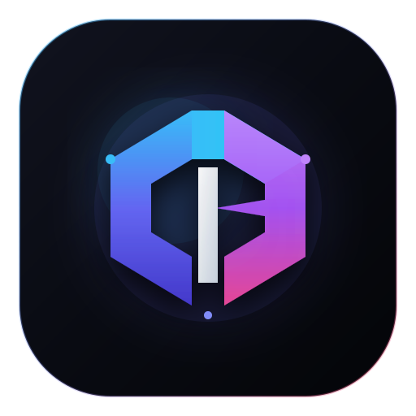

<p align="center">
  
</p>

<h1 align="center">T3 Code IDE</h1>

<p align="center">
  <strong>The open-source, AI-native development environment where coding agents live inside your editor.</strong><br>
  Unified Monaco editor, multi-root workspaces, Open VSX extensions, and docked multi-agent orchestration across Claude Code, Codex, Cursor CLI, Grok Build, OpenCode, and Antigravity.
</p>

<p align="center">
  <a href="https://github.com/ParasKoundal/t3code-ide/releases/latest"></a>
  <a href="https://open-vsx.org"></a>
  <a href="https://github.com/ParasKoundal/t3code-ide/blob/main/LICENSE"></a>
</p>

---

## 💡 Why T3 Code IDE?

Developers currently juggle a fractured workflow: VS Code in one window, Claude Code in a terminal tab, Cursor for inline diffs, web chat tabs for questions, and separate CLIs with no shared context.

**T3 Code IDE unites the entire loop into a single, cohesive desktop workbench.**

```
+-------------------+-----------------------------------------------+-------------------------------+
| ACTIVITY &        | MONACO CODE EDITOR                            | MULTI-AGENT CONTROL DECK      |
| WORKSPACES        |                                               |                               |
|                   |  [App.tsx] [main.rs] [schema.prisma]          |  [Claude 3.7] [Codex] [Grok]  |
| 📂 Workspaces     |  1 | import React from "react";               |                               |
|    ├── web/       |  2 |                                          |  ⚡ Turn 3 / 5:               |
|    ├── server/    |  3 | // Inline Agent Edit [Cmd+K]             |  "Refactoring SQLite schema   |
|    └── mobile/    |  4 | export function App() { ... }            |   and adding WAL journal..."  |
|                   |                                               |                               |
| 🌿 Git Changes    |                                               |  [Diff Preview: +34 -8 lines] |
|    • M App.tsx    |                                               |  [Accept] [Reject] [Steer]    |
|                   +-----------------------------------------------+                               |
| 🧩 Open VSX Exts  | DOCKED TERMINAL DRAWER (Ctrl+`)               |  > Type prompt or /command    |
|    • Tokyo Night  | $ pnpm test --watch                           |  [Queue Action] [Steer Model] |
+-------------------+-----------------------------------------------+-------------------------------+
```

---

## 🚀 1-Click Direct Downloads

Pre-built binaries are packaged for macOS, Windows, Linux, and mobile companions. **No Node.js, Rust toolchains, or terminal setup required.**

| Platform    | Download                                                                                                                            | Architecture / Package             | Notes                               |
| :---------- | :---------------------------------------------------------------------------------------------------------------------------------- | :--------------------------------- | :---------------------------------- |
| **macOS**   | [**Download .DMG**](https://github.com/ParasKoundal/t3code-ide/releases/latest)                                                     | Apple Silicon (`arm64`, M1–M4)     | Drag-and-drop to `/Applications`    |
| **macOS**   | [**Download .DMG**](https://github.com/ParasKoundal/t3code-ide/releases/latest)                                                     | Intel (`x64`)                      | Drag-and-drop to `/Applications`    |
| **Windows** | [**Download .EXE**](https://github.com/ParasKoundal/t3code-ide/releases/latest)                                                     | Windows 10 / 11 (`x64` NSIS Setup) | 1-Click Installer with WSL support  |
| **Linux**   | [**Download .AppImage**](https://github.com/ParasKoundal/t3code-ide/releases/latest)                                                | Standalone Portable (`x64`)        | `chmod +x` and run directly         |
| **Android** | [**Download .APK**](https://github.com/ParasKoundal/t3code-ide/releases/latest)                                                     | Universal Android (`.apk`)         | Mobile companion for phone & tablet |
| **iOS**     | [**App Store**](https://apps.apple.com/app/t3-code/id6739832262) \| [**TestFlight Beta**](https://testflight.apple.com/join/t3code) | iPhone & iPad                      | Official Apple mobile companion     |

> [!TIP]
> **Release Verification**: All builds, release hashes, and changelogs are available on the [GitHub Releases Page](https://github.com/ParasKoundal/t3code-ide/releases).

---

## ⚡ Core Superpowers

### 🤖 Cross-Provider Multi-Agent Orchestration

Never get locked into a single AI model or proprietary cloud. Switch between **Claude 3.7 Sonnet**, **OpenAI Codex**, **Cursor CLI**, **Grok Build**, **OpenCode**, and **Google Antigravity** within the exact same workspace and conversation thread. Steer running models, queue follow-ups, and review streamed tool operations in real time.

### ✏️ Cursor-Style Inline Code Edit (`Cmd+K` / `Ctrl+K`)

Highlight any selection in the Monaco editor, press `Cmd+K`, and prompt the agent directly inside your file buffer. Inspect syntax-highlighted diffs side-by-side and accept or reject individual hunks before touching disk.

### 🧩 Built-in Open VSX Extension & Theme Marketplace

Search, install, configure, and toggle extensions and color themes directly from [Open VSX](https://open-vsx.org). Enjoy Tokyo Night, Catppuccin, One Dark, and language packs in a fully open-source environment free of proprietary vendor tracking.

### 📂 Multi-Root Workspaces & Worktree Scopes

Organize complex codebases by grouping multiple directories, microservices, or monorepo packages under persistent workspace scopes. Chat threads and terminal drawers automatically track their respective root context and Git state.

### 💻 Integrated Docked Terminal Drawer (<code>Ctrl+`</code>)

Never leave your editor to run scripts. Open the docked terminal drawer beneath Monaco to execute tests, run dev servers, or invoke CLI tooling with shared environment variables.

### 📱 Real-Time Mobile Companion (iOS & Android)

Step away from your desk while an agent runs a heavy build or deep refactor. Scan the local QR code (**Settings → Connections**) to pair your smartphone or tablet over your local WiFi or Tailscale mesh. Monitor progress, approve file diffs, and prompt agents from anywhere.

---

## 📊 How T3 Code IDE Compares

| Feature                        |                      T3 Code IDE                       |         Cursor          | VS Code + Plugins  | Terminal Agent CLIs |
| :----------------------------- | :----------------------------------------------------: | :---------------------: | :----------------: | :-----------------: |
| **Supported AI Agents**        | **Claude, Codex, Cursor, Grok, OpenCode, Antigravity** | Proprietary Cursor only |  Plugin-dependent  |  Single agent only  |
| **Integrated Monaco Editor**   |                       ✅ **Yes**                       |         ✅ Yes          |       ✅ Yes       |        ❌ No        |
| **Inline Code Edit (`Cmd+K`)** |                       ✅ **Yes**                       |         ✅ Yes          |  Plugin-dependent  |        ❌ No        |
| **Open VSX Marketplace**       |                    ✅ **Built-in**                     |   ❌ Proprietary fork   | ❌ Microsoft store |        ❌ No        |
| **Multi-Root Workspaces**      |                       ✅ **Yes**                       |         ✅ Yes          |       ✅ Yes       |        ❌ No        |
| **Docked Terminal Drawer**     |                       ✅ **Yes**                       |         ✅ Yes          |       ✅ Yes       |   Separate window   |
| **Mobile Companion Pairing**   |               ✅ **Yes (iOS & Android)**               |          ❌ No          |       ❌ No        |        ❌ No        |
| **100% Open Source (MIT)**     |                       ✅ **Yes**                       |          ❌ No          |  Partially (Core)  |       Varies        |

---

## ⌨️ Productivity Keyboard Shortcuts

| Shortcut (macOS / Windows)     | Action                                                |
| :----------------------------- | :---------------------------------------------------- |
| `Cmd+Shift+I` / `Ctrl+Shift+I` | **Toggle IDE Mode ⇄ Chat-First Mode**                 |
| `Cmd+K` / `Ctrl+K`             | **Inline Agent Code Edit in Editor Buffer**           |
| <code>Ctrl+`</code>            | **Toggle Docked Terminal Drawer**                     |
| `Cmd+B` / `Ctrl+B`             | **Toggle Left Sidebar (Explorer / Git / Extensions)** |
| `Cmd+P` / `Ctrl+P`             | **Quick Open File / Command Palette**                 |
| `Cmd+Shift+M` / `Ctrl+Shift+M` | **Switch AI Model / Agent Provider**                  |
| `Cmd+Shift+G` / `Ctrl+Shift+G` | **Git Branch & Worktree Switcher**                    |
| `Cmd+Shift+X` / `Ctrl+Shift+X` | **Switch Active Workspace Scope**                     |
| `Cmd+Enter` / `Ctrl+Enter`     | **Send Prompt / Steer Running Turn**                  |

---

## 🚦 Getting Started in 60 Seconds

### Step 1: Install & Launch

Download the installer for your platform from the [Releases](https://github.com/ParasKoundal/t3code-ide/releases/latest) table above and launch **T3 Code IDE**.

_(macOS Gatekeeper tip: Right-click app → **Open**, or run `xattr -cr "/Applications/T3 Code IDE.app"`. Windows tip: Click **More info → Run anyway**)._

### Step 2: Authenticate Any Provider

T3 Code IDE talks directly to local agent CLIs on your machine. Authenticate at least one provider:

```bash
# Claude Code
claude auth login

# OpenAI Codex
codex login

# Cursor CLI
agent login

# Grok Build
grok login

# OpenCode
opencode auth login

# Google Antigravity
# Open Settings → Providers in T3 Code IDE, click "Install Antigravity" and Sign in with Google.
```

### Step 3: Open Your Project & Build

Press `Cmd+O` to open your project directory, choose your model from the top-right selector, and start coding!

---

## 🛠️ Building from Source (Contributors)

T3 Code IDE uses [Vite+](https://vite.plus) for unified package management and rapid builds.

```bash
# 1. Install Vite+ package manager
curl -fsSL https://vite.plus | bash          # macOS / Linux
irm https://vite.plus/ps1 | iex              # Windows PowerShell

# 2. Clone repository & install dependencies
git clone https://github.com/ParasKoundal/t3code-ide.git
cd t3code-ide
vp i

# 3. Start development server (web client + backend)
npm run dev

# 4. Or compile desktop installers locally:
npm run dist:desktop:dmg                     # macOS .dmg
npm run dist:desktop:win                     # Windows .exe installer
npm run dist:desktop:linux                   # Linux .AppImage
```

---

## 📖 In-Depth Documentation

- [**IDE Layout & Workspaces Guide**](./docs/user/ide-layout.md)
- [**Installation & Remote Access**](./docs/user/install.md)
- [**Full Keyboard Shortcuts Reference**](./docs/user/keybindings.md)
- [**Permission Modes & Sandboxing**](./docs/user/permission-modes.md)
- [**Mobile Companion App Pairing**](./docs/user/remote-access.md)
- [**Language Server (LSP) Setup**](./docs/user/outside-agents.md)
- [**Git & Source Control Integrations**](./docs/user/source-control.md)
- [**Architecture & Internals Overview**](./docs/internals/overview.md)

---

## License

MIT © [Paras Koundal](https://github.com/ParasKoundal) & original contributors.
